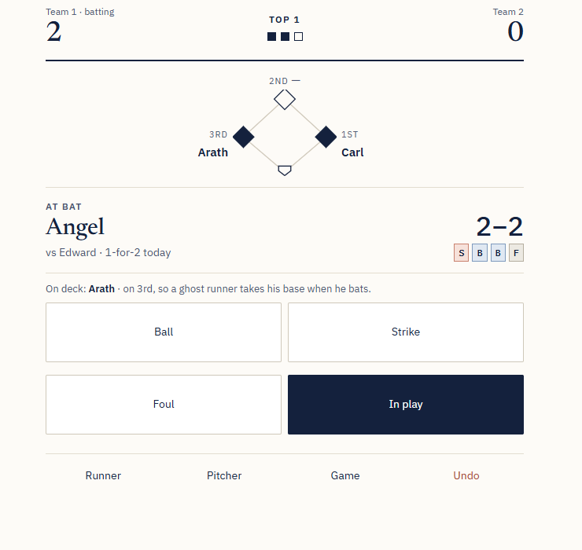
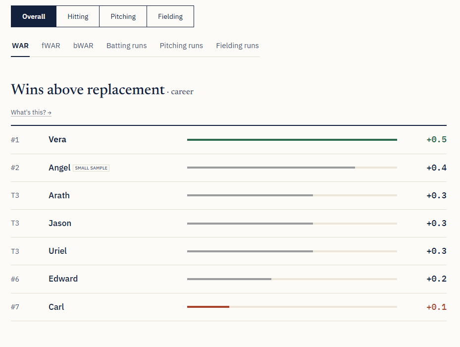
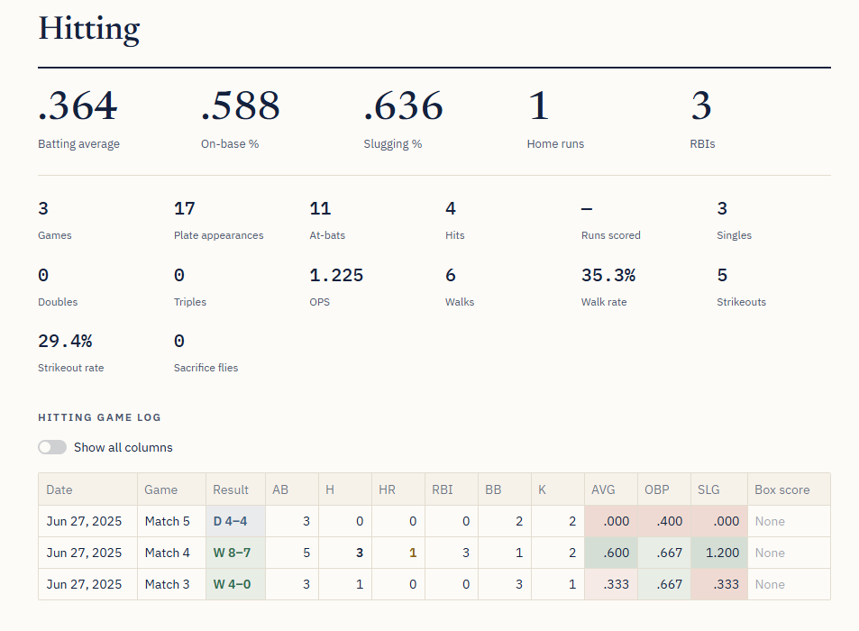
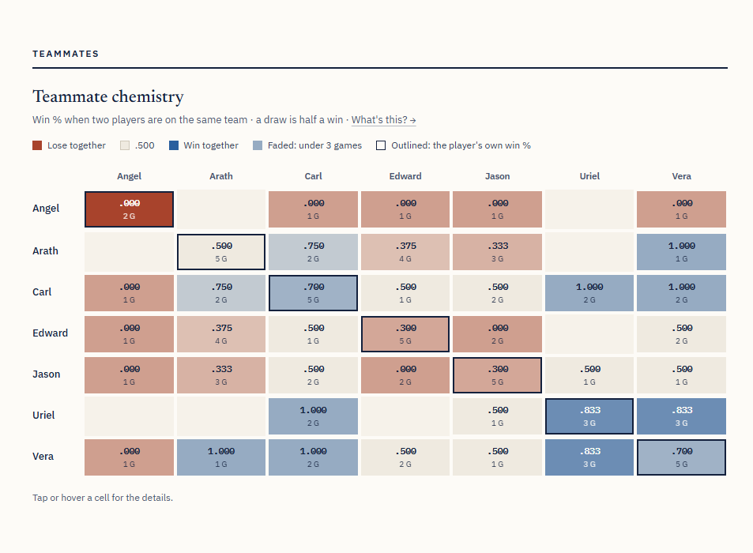

# Wiffle Ball Stat Tracker

A Streamlit web app, backed by MongoDB, for scoring pickup Wiffle and Blitzball games pitch by pitch and turning them into box scores, standings, sabermetric stats and records.

**Live app:** [wiffle.streamlit.app](https://wiffle.streamlit.app). Open the Scorekeeper and tap **Try practice mode** to score a game yourself (nothing is saved).

<p align="center">
  
  
  
  
</p>

## Features

**Scoring a game**
- **Live Scorekeeper**: a phone-first, password-protected screen for scoring pitch by pitch: balls, strikes and fouls, every type of ball in play, where each runner ended up, steals, caught stealing, pickoffs, errors and pitching changes, with undo at any point.
- **The rules built in**: ghost runners for short lineups, an optional all-time player who bats or pitches for both teams, 2- or 3-out half-innings, walk-offs, ties with extra innings, and earned vs unearned runs.
- **Safe for two phones**: a double tap or a second phone scoring at the same time is detected and skipped, so nothing is ever recorded twice.
- **Practice mode**: try the Scorekeeper in a throwaway sandbox that never touches the real data.

**Following and looking back**
- **Live**: a read-only scoreboard that updates itself every few seconds while a game is being scored.
- **Game Log**: every game with results, scoring plays and a full box score (batting, pitching and play-by-play).
- **Player Dashboard** and **Player Matchups**: career and season stats per player, and head-to-head batter vs pitcher breakdowns.

**Stats**
- **Standings**: hitting, pitching and fielding leaderboards by season or career, with standard and advanced stats (wOBA, wRC+, ISO, BABIP, FIP, ERA-, K-BB%) and small-sample flags.
- **WAR**: wins above replacement from batting, pitching, fielding and replacement runs, scored season by season against that season's league.
- **Records**: season awards (MVP, Pitcher and Hitter of the Year, Gold Glove, Most Improved), single-game records, hitting streaks and milestone watch.
- **Visualizations**: percentile rankings, a WAR race, outcome mixes, pressure splits, a batter vs pitcher grid, teammate chemistry and more, with tap-friendly tooltips.
- **Glossary**: every stat with its formula and a live example from the league.

## How it works

- **Each game is stored as a list of events** (every pitch, play, runner move and setting change). The game engine (`game_engine.py`) rebuilds the full game state by replaying those events, so undo is just removing the last one, and the scoreboard, box score and stats always come from one source of truth.
- **Every tap is validated before it's saved**: an illegal play (a runner passing another, more outs than are left) is rejected instead of saved. Saves are conditional on the number of events the phone last saw, which is how double taps and two phones are caught.
- **Stats are computed with pandas** from the games and at-bats (`stats.py`) and cached briefly, so pages stay quick.

**Stack:** Python, Streamlit, MongoDB Atlas, pandas, Plotly.

## Run it locally

You'll need Python 3.13 and a MongoDB database (a free [MongoDB Atlas](https://www.mongodb.com/atlas) cluster works).

1. Clone the repository:
   ```sh
   git clone https://github.com/edwardquez/Wiffle-Ball-Tracker.git
   cd Wiffle-Ball-Tracker
   ```
2. Create and activate a virtual environment:
   ```sh
   python -m venv venv
   venv\Scripts\activate          # Windows
   source venv/bin/activate       # macOS / Linux
   ```
3. Install the dependencies:
   ```sh
   pip install -r requirements.txt
   ```
4. Create a `.env` file in the project folder:
   ```
   MONGO_URI=your_mongodb_connection_string
   ADMIN_PASSWORD=a_password_for_the_scorekeeper
   ```
5. Run the app:
   ```sh
   streamlit run Home.py
   ```

## Tests

```sh
python -m pytest tests
```

The tests cover the game engine (including thousands of randomly played games checked for consistent bookkeeping), the stats and box scores, and the real Scorekeeper page played through special situations such as walk-offs, extra innings, undo and two phones at once. They use an in-memory database, so they never touch real data.

## Contact

Edward Quezada · edwardq@alumni.stanford.edu


